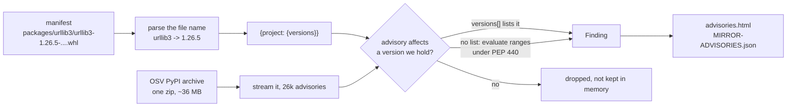

# Known vulnerabilities

An air-gapped network is slower to patch than any other, because a fix travels at the
speed of the next delta. The least this tool can do is say, at the moment it publishes,
which of the packages it just mirrored have advisories against the exact versions it
chose — and send that answer across the air gap with them, so the people who cannot query
an API still have the list.

Each run writes two things into the mirror:

| File | For |
| --- | --- |
| `advisories.html` | People. A report: summary by severity, findings grouped and numbered, scope, limitations. Linked from the mirror's landing page and printable to PDF. |
| `MIRROR-ADVISORIES.json` | Machines. The same findings, plus the counts and the caveat, for a dashboard or a ticket script. |

## How the match is made



OSV publishes its whole PyPI advisory set as a single archive, which is what makes this
practical: matching a few thousand `(project, version)` pairs is a local join over one
download, not thousands of API calls from a machine already making enough of them. The
scan takes about three seconds.

Where an advisory enumerates its affected versions, that list wins — it is what the
advisory's author actually checked, and it sidesteps every disagreement about how a range
endpoint compares. Where it does not, the ranges are evaluated with `packaging`'s PEP 440
ordering, honouring `introduced`, `fixed` and `last_affected`. Withdrawn advisories and
other ecosystems are skipped, and versions are compared rather than string-matched, so an
advisory that says `1.0` still matches a file that says `1.0.0`.

## What it does not claim

Three things are said on the report itself, because a security report that oversells
itself is worse than none:

- **It is a snapshot** of the advisory set when the mirror was built. Re-running the
  mirror refreshes it.
- **Advisory data has false positives and gaps.** A package absent from the report has
  not been shown to be free of defects.
- **Severity is the publisher's**, taken from the database unchanged, not reassessed
  against your environment.

And one more that follows from where it sits in the pipeline: the scan covers what the
mirror *contains*, not what any project installs. A finding against a version nobody
depends on is noise, and the report cannot tell the difference.

## Failing a run on findings

```toml
[security]
advisories = true
fail_on = "none"   # or low, moderate, high, critical
```

`fail_on` is `none` by default, and that is a deliberate default rather than a timid one:
mirroring the top 1000 projects will always find something, and a sync that exits
non-zero every month trains everybody to ignore it. Set it when the scope is small enough
that a finding is genuinely exceptional, or when policy requires the pipeline to stop.

If no advisory source is reachable, the cached copy is used and the report says so. The
fallback is the same reasoning as the top list: a run that silently scanned nothing would
report a clean mirror, which is worse than reporting an old answer and labelling it old.
