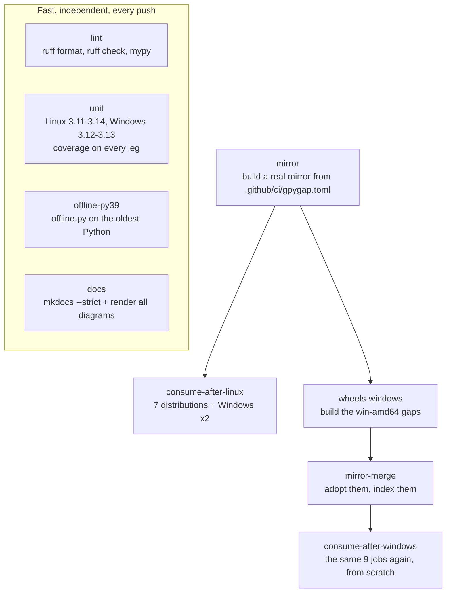
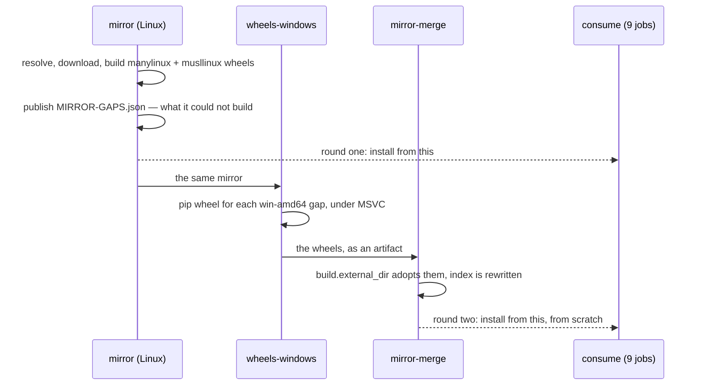
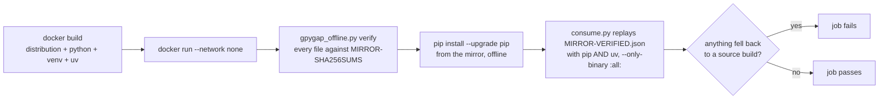

# What CI does, and what it proves

This project makes one claim that matters: **a developer in an air-gapped network
installs a package without a compiler and without a network.** Linting and unit tests
cannot test that claim. They test that the code is tidy and that its pure logic is
right, which is necessary and nowhere near sufficient.

So CI builds a real mirror and then installs from it, offline, on every system the
mirror says it serves. Everything below exists to make that sentence true rather than
aspirational.

## The job graph



The four fast jobs answer in a couple of minutes. The chain underneath takes longer and
is the part worth reading.

## The fast jobs

| Job | What it catches |
| --- | --- |
| `lint` | Formatting, lint rules, and `mypy --strict` over `src` and `tests`. |
| `unit` | The pure logic, on Linux 3.11–3.14 **and Windows 3.12–3.13**. |
| `offline-py39` | `offline.py` running on Python 3.9, in a container. |
| `docs` | `mkdocs build --strict`, then every Mermaid diagram rendered. |

Two of those deserve a reason.

**Windows is in the unit matrix, not only in the consume jobs.** The suite is mostly path
handling — mirror-relative POSIX paths, `file://` index URLs, temporary directories — and
a separator assumption passes on Linux and greets a developer in Warsaw on a Monday.
Coverage is collected on every leg and written into the GitHub job summary.

**Diagrams are rendered, not just built.** `mkdocs --strict` cannot see inside a
` ```mermaid ` fence, so a diagram that does not parse reaches the published site as
"Syntax error in text" and is discovered by a reader. The `docs` job extracts every fence
and renders it with the real Mermaid renderer. This check exists because exactly that
happened once.

## Two mirrors, not one



Round one asks whether every system can install from what Linux alone could build. Round
two asks the same question again after a Windows runner supplied what Linux cannot make —
and expects *more* packages to install, not merely the same ones.

This is not a CI curiosity. It is the shape a monthly cycle has in production: one run
publishes what is missing, a Windows machine builds it, the next run folds it in. CI runs
both halves back to back so the loop is exercised on every push.

## What a consume job actually does

Each of the nine consume jobs installs from the mirror the way a developer would, and
every part of how it does that is load-bearing.



- **The network is cut, and the cut is proven.** Linux containers run with
  `--network none`. Windows has no such flag, so the runner gets an outbound firewall
  rule for `python.exe` and `uv.exe` plus a proxy pointed at a closed port — belt and
  braces, because a proxy only works for tools that choose to honour it and a firewall
  rule does not need their cooperation.

    Both platforms then run the same control: reach for `https://pypi.org/simple/` and
    **require it to fail**. If it succeeds the job stops there, because everything after
    it would be passing for the wrong reason. A test of offline behaviour that never
    checks it is actually offline is the easiest kind of green tick to get and the least
    worth having.
- **`--only-binary :all:`** is the claim itself. Without it, a missing wheel is a slow
  install; with it, a missing wheel is a failed job.
- **Both pip and uv.** They disagree — they read the PEP 658 sidecars differently — and
  only one of them has ever rejected a mirror this project produced.
- **pip is upgraded from the mirror first**, offline. Debian 12 ships pip 23.0.1, which
  rejects a wheel whose metadata name normalizes differently from the requested name once
  it reads those sidecars; fixed in 23.1. Doing it here is both the documented remedy and
  a proof the mirror can bootstrap its own tooling with the network off.
- **The checks are the mirror's own.** `consume.py` reads `MIRROR-VERIFIED.json`, the file
  the online side wrote when it verified itself, and replays those checks with this
  machine's real pip and uv. CI does not invent its own list of packages to try.

### Why these distributions

| Image | There because |
| --- | --- |
| `debian:12` | Oldstable, and it ships the pip version the PEP 658 bug bites. Removing it would make the bootstrap step decorative. |
| `debian:13` | Current stable. |
| `ubuntu:24.04`, `ubuntu:26.04` | What most developer machines actually run. |
| `registry.access.redhat.com/ubi9/ubi` | The whole EL9 family — RHEL, Rocky, Alma, Oracle — which is what tends to be in a locked-down network. Its default `python3` is 3.9, so CI installs 3.12 explicitly. |
| `archlinux:latest` | Rolling: it finds things the frozen distributions will find in two years. |
| `alpine:3.20` | **musl, not glibc.** A manylinux wheel does not install here, so this leg checks the `linux-musl-x86_64` target and nothing else does. |

Each matrix entry names its own platform key, which is how the Alpine job came to be
checked against musl instead of silently demanding glibc wheels on a musl system.

## The CI mirror is small on purpose

`.github/ci/gpygap.toml` mirrors the top 5 projects plus four named ones, for Python
3.11–3.14 on glibc, musl and Windows. It is about 140 MB and a minute, and every extra
package in it earns its place:

| Package | Why it is there |
| --- | --- |
| `pip` | So the offline pip upgrade has something to upgrade from. |
| `docopt` | No wheels at all, pure Python: builds once to `py3-none-any` and covers every target, including Windows. |
| `pysendfile` | No wheels, a C extension, Linux-only: exercises `pip wheel` plus `auditwheel` in manylinux and musllinux containers. |
| `llist` | No wheels, a C extension, cross-platform: Linux builds it for Linux, which does nothing for `win-amd64`, so the Windows builder has real work. Round two installs it and imports the resulting `.pyd`. |

Without that last one the hand-back loop ran green while doing nothing, which is worse
than not having it.

## Releases

A tag `v*` runs `release.yml`: it refuses a tag whose version disagrees with
`pyproject.toml`, runs **the whole of CI** through `workflow_call`, and only then
publishes the sdist, the wheel, `gpygap_offline.py`, `SHA256SUMS` and the container image
to ghcr.io. Nothing is published by a run that has not proved the thing it is publishing
works.

## What CI does not test

Worth knowing before trusting a green tick:

- **Scale.** CI mirrors a handful of projects. The real thing is the top 1000, roughly
  80 GB, several hours and hundreds of builds. Timeouts, memory and prune ratios behave
  differently there.
- **The Windows online machine.** `bin/gpygap.ps1` and the path translation in
  [online-on-windows.md](online-on-windows.md) are checked by hand. Every CI job runs a
  Linux host.
- **macOS.** Not built, not consumed, not targeted.
- **A real air gap.** `--network none` and a blackholed proxy are good imitations of one,
  but they are imitations.
- **aarch64.** The platform is supported and the wheels can be built under emulation;
  CI runs on x86-64 only.

## Running the same checks locally

```bash
uv run ruff format src tests && uv run ruff check src tests
uv run mypy
uv run pytest -q                                  # with coverage
uv run --group docs mkdocs build --strict
bin/check-offline-py39
bin/gpygap sync --config .github/ci/gpygap.toml   # the mirror CI builds
```

`GPYGAP_ENGINE=docker` switches the container wrapper from podman to docker, which is how
the same scripts run unchanged on a GitHub runner.
