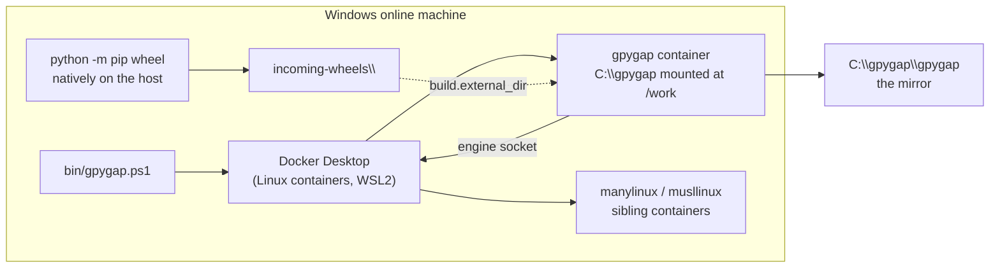

# Running the online side on Windows

The online machine does not have to be Linux. Running it on Windows costs a little
setup and buys the one thing a Linux host cannot do: **it builds the Windows wheels
itself**, instead of publishing them as gaps for somebody else to fill.

!!! warning "Tested by hand, not by CI"
    Every CI job runs the Linux host. This page is supported and the pieces it uses are
    the same ones CI exercises, but the Windows wrapper itself is checked manually. If
    you run this arrangement and something does not match, that is worth an issue.

## What changes, and what does not

Almost nothing changes. The mirror is built inside the same Linux container image, by the
same code, producing the same `simple/` index. What differs is outside the container:



| | Linux host | Windows host |
| --- | --- | --- |
| Wrapper | `bin/gpygap` (bash, podman) | `bin/gpygap.ps1` (PowerShell, Docker Desktop) |
| Project path inside | the same absolute path as outside | `/work` |
| Sibling container paths | identity | translated via `build.container_root` / `build.host_root` |
| Linux wheels | built in manylinux/musllinux containers | the same, through the WSL2 backend |
| Windows wheels | a gap, or adopted from `build.external_dir` | **built on this machine**, then adopted |

## Why the path translation is needed

On Linux the wrapper mounts the project directory at the same absolute path inside the
container as outside, so a sibling container can mount the same host path and every
mirror-relative path still resolves. On Windows that trick is unavailable: the mirror is
`/work/gpygap` inside and `C:\gpygap\gpygap` outside, and the engine — which creates the
sibling — only understands the second one.

So `gpygap.toml` carries the mapping:

```toml
[build]
container_root = "/work"
host_root = "C:\\gpygap"
```

Both or neither; the configuration refuses one without the other. With them set, gpygap
rewrites the `--volume` arguments of its builder containers and leaves the paths inside
alone.

## Setting it up

1. **Docker Desktop** with the WSL2 backend, in *Linux containers* mode (the default).
   Podman Desktop works the same way. Windows containers are not used and not needed.
2. **Clone the repository** somewhere without spaces in the path, for example
   `C:\gpygap`.
3. **Edit `gpygap.toml`**: add the `container_root` / `host_root` pair above, and point
   `build.external_dir` at a directory for the wheels this machine builds natively:
   ```toml
   [build]
   external_dir = "incoming-wheels"
   container_root = "/work"
   host_root = "C:\\gpygap"
   ```
4. **Run it**:
   ```powershell
   .\bin\gpygap.ps1 sync --config gpygap.toml
   ```

## Building the Windows wheels on the same machine

The first run publishes `MIRROR-GAPS.json`: every `(package, platform, Python version)`
still without a wheel. On a Windows host those are exactly the ones this machine can
build, with the MSVC Build Tools installed:

```powershell
python .\.github\ci\build-windows-wheels.py .\gpygap .\incoming-wheels
.\bin\gpygap.ps1 sync --config gpygap.toml      # adopts them
```

Run it once per Python version in `targets.python` — `py -3.12`, `py -3.13` and so on —
because a compiled extension's wheel serves one interpreter. A pure-Python package needs
only one run: its `py3-none-any` wheel covers every target, Linux included.

Two runs rather than one is not an accident of the tooling: it is the same shape as a
monthly cycle, where one run publishes what is missing and the next folds in what was
built in between.

## What is still not possible

macOS. Neither host builds for it, for the same reason Linux does not build for Windows,
and no amount of configuration changes that. If your developers use macOS, add
`macos-arm64` to `targets.platforms` to mirror the wheels that exist upstream, and expect
`MIRROR-GAPS.json` to name the rest.
