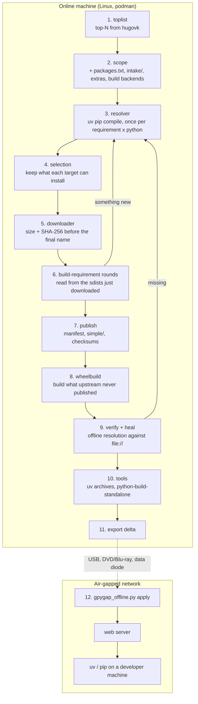
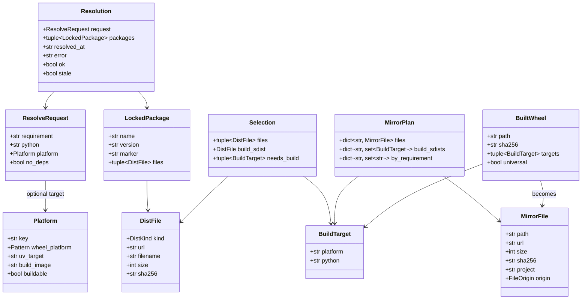
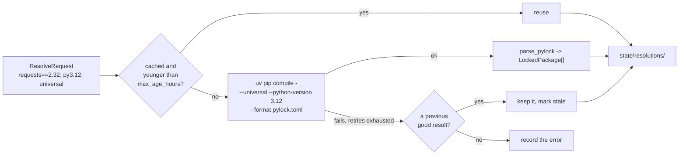
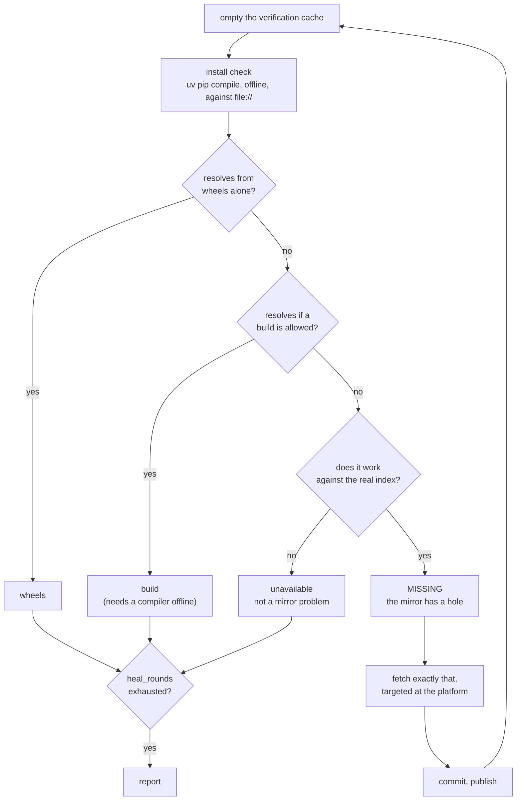
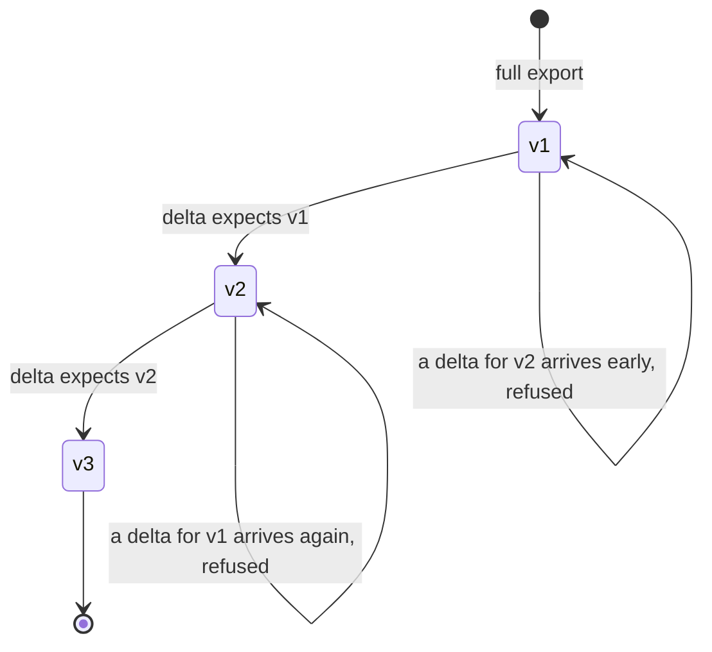
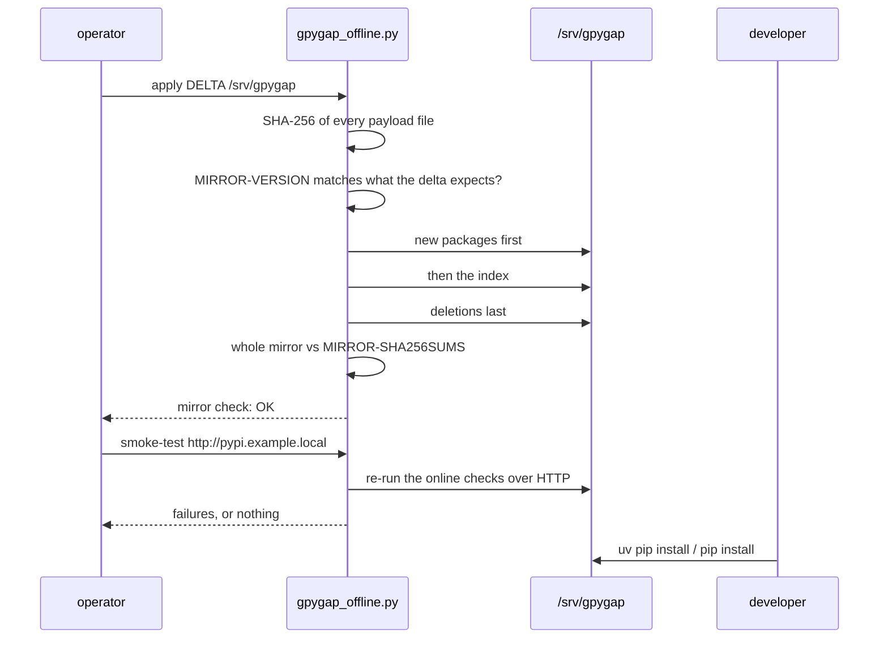

# The pipeline, end to end

How a project goes from a line in a download-count ranking to an `import` on a machine
with no route to the internet. Every stage names the module that performs it, so this
page and the code can be read side by side.

## The whole run at a glance

## The data that flows

Everything crossing a module boundary is a frozen dataclass, never a dict.

## 1. Asking what the top 1000 are

`toplist.py` fetches the ranking published by
[hugovk/top-pypi-packages](https://hugovk.github.io/top-pypi-packages/), takes the first
`packages.top` names after removing `packages.exclude`, and caches it in the state
directory.

If none of `packages.top_sources` is reachable, the cached copy is used. That fallback is
not politeness: a run that silently mirrored zero top projects would conclude that almost
every file in the mirror is unneeded, and the prune would act on it.

## 2. Working out the scope

`sync._fetch_scope` assembles everything the mirror must make installable:

| Source | Module | What it contributes |
| --- | --- | --- |
| The ranking | `toplist.py` | `packages.top` project names |
| `packages.extra` + `packages.txt` | `config.py` | our own requirements, with specifiers |
| `intake/*.txt` | `intake.py` | requirement lines from teams |
| `intake/uv.lock`, `pylock*.toml` | `intake.py` | exact pins, resolved `--no-deps` |
| Extras of all of the above, except pins | `extras.py` | one requirement per `Provides-Extra` |
| Build backends | `sync.SEED_BUILD_REQUIREMENTS` | setuptools, hatchling, maturin, cmake … |
| Fixes from earlier runs | `sync._load_fixes` | targeted resolutions that healed a gap before |

Extras are discovered from metadata the mirror already has, or over PEP 658 from the
index, and resolved **one at a time**: `uvicorn[standard]` and `uvicorn[test]` can pin
different versions of the same dependency, and resolving them together would quietly pick
one.

## 3. Resolution

`resolver.py` runs one `uv pip compile` per `(requirement, python version)`, usually
`--universal` so one resolution serves every platform. Resolving the whole scope as a
single set would be faster and would fail completely the first time two of a thousand
projects disagree; one resolution per requirement keeps a conflict local to the
requirement that caused it.

A stale result is preferred to no result. A transient failure must never make files look
unneeded.

## 4. Selection

A universal resolution lists every wheel of every pinned version — Windows, macOS, PyPy,
every interpreter. `selection.py` keeps only what a configured target can install:

- the package's environment marker is evaluated per `(platform, python)`, with the patch
  version tried at both ends of the range, and a package excluded everywhere is dropped;
- each wheel's tags are matched against the platform's tag pattern and the interpreter;
- the free-threaded ABI is treated as a different ABI, not a newer one: `cp313t` does not
  run on 3.13 and `cp313` does not run on 3.13t;
- when a target has no compatible wheel, that exact `(platform, python)` is recorded as a
  `BuildTarget`, which is what stage 8 consumes.

The result is a `MirrorPlan`: every file the mirror should contain, by path.

## 5. Download

`downloader.py` fetches what is missing, in parallel, and checks size and SHA-256 against
the lock file before renaming the temporary file to its final name. **A file under its
final name is complete and verified** — an interrupted run leaves nothing a later run
would mistake for present.

## 6. Build-requirement rounds

`fetcher.py` reads `build-system.requires` out of each sdist that some target must build
— statically, from the `pyproject.toml` inside the archive, which is never extracted —
and resolves those too. Their sdists can have build requirements of their own, so the
loop repeats until a round adds nothing new, bounded by `sync.build_deps_rounds`.

## 7. Publishing

`manifest.py` records every file this run requires; `index.py` writes the PEP 503
`simple/` pages from the manifest, filtered by what is actually on disk, with each link
carrying `#sha256=`, `data-requires-python` and a PEP 658 metadata sidecar;
`checksums.py` writes `MIRROR-SHA256SUMS`; `prune.py` deletes what no retained run needs,
behind the ratio limit.

Pruning happens **after** stage 8, not here: the wheels a previous run built are known
only to the builder, and pruning before it runs would delete the files its cache is about
to reuse.

## 8. Building the missing wheels

See [Wheels we build](wheels.md) for the whole story. In one sentence: every
`(platform, python)` with no upstream wheel is built in a sibling manylinux or musllinux
container, `auditwheel`-retagged, and published next to its sdist with
`origin = "built"`; what no container here can build is named in `MIRROR-GAPS.json`.

## 9. Verification and healing

This is the stage that decides whether the mirror ships.

Two things make this a proof rather than a demonstration. The verification cache is
emptied before every round, so uv cannot answer from something it downloaded earlier; and
a failure is re-run against the real index, so "this project does not support that
target" is told apart from "the mirror is missing a file".

Build checks run in parallel with the install checks: each sdist that some target must
build is built offline against the mirror, in an image with no compilers. Dependency
resolution happens before compilation starts, which is the part a mirror can be missing;
a compiler error afterwards arrives in seconds and is not a mirror problem.

Healing is bounded by `sync.heal_rounds`, and a fix that worked is written to
`state/targeted-resolutions.json` so the next run starts with it instead of rediscovering
the same gap.

## 10. Tools

`tools.py` mirrors the uv release archives and the python-build-standalone builds for
every target, because a developer on the air-gapped side cannot install uv from the
internet. Which Python build `uv python install` asks for is compiled into uv, so the uv
version is pinned in the `Containerfile` and the mirrored builds come from that version.

## 11. Export

A delta holds the files that changed since the last export plus the list of deletions, and
it names the mirror version it expects. Applying them out of order, twice, or with a
damaged payload is refused before the first file is touched. Deltas travel by USB,
DVD/Blu-ray or a data diode; see [Operations](operations.md).

## 12. The air-gapped side

`gpygap_offline.py` is one file, imports only the standard library and runs on Python 3.9,
because the server it lands on has nothing installed. The order of operations is safe for
a live server: new files appear before the index that points at them, and deletions
happen last.

## Where state lives

Only the mirror crosses the air gap. `gpygap-state/` never leaves the online machine:
resolutions, the uv cache, the verification cache, per-run history, the manifest, the
dist-metadata cache, the wheel-build cache and the export snapshot. Losing it costs a
slow run, not correctness.
