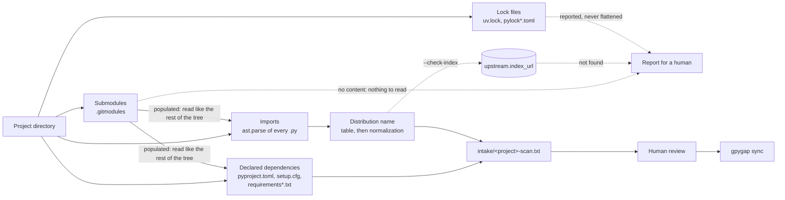

# Scanning a project directory

`intake/` answers "mirror exactly what this lock file pins". `gpygap scan` answers the
question that comes before it: somebody hands over a directory that was never packaged — a
simulation harness, a pile of scripts, a vendor drop — and a human has to say which
distributions it will not start without.

Doing that by eye, file by file, is how a mirror ends up one package short. The person who
finds out is the one with no way to download it.

```bash
gpygap scan /srv/projects/uart_hw
```

```text
I Scan /srv/projects/uart_hw: 2 requirements from 7 Python files, 0 unmatched imports
2 requirements -> /srv/gpygap/intake/uart-hw-scan.txt
```

The command writes a requirements file and changes nothing else. It never resolves, never
downloads and never touches the mirror; the next `sync` picks the file up like any other
intake file.

## Where it gets its answers



**Declared dependencies** are taken at their word, version specifiers included:

| File | What is read |
| --- | --- |
| `pyproject.toml` | `project.dependencies`, `project.optional-dependencies`, PEP 735 `dependency-groups`, `build-system.requires` |
| `pyproject.toml` (Poetry) | the names under `tool.poetry.dependencies`; `^1.2` is not PEP 508, and inventing an upper bound would be a guess |
| `setup.cfg` | `options.install_requires`, `options.setup_requires`, `options.extras_require` |
| `requirements*.txt` | every requirement line; options (`-r`, `--hash`, `--index-url`) are dropped |

**Imports** are the part that matters for an unpackaged tree. Every `.py` and `.pyi` file is
parsed with `ast` — not grepped, so an import inside a function body counts too — and what
survives three filters has to come from an index:

- relative imports (`from . import x`) are not distributions;
- the standard library, by `sys.stdlib_module_names`;
- modules the tree provides itself: the stem of every scanned file, and the name of every
  directory with an `__init__.py`. A testbench doing `from commons import *` is importing the
  file next to it, and mirroring a PyPI project called `commons` would be worse than useless.

What is left is turned into a distribution name by a table of the names that differ by more
than punctuation (`yaml` → `pyyaml`, `PIL` → `pillow`, `cv2` → `opencv-python`), and otherwise
by PEP 503 normalization, which is all `cocotb_bus` → `cocotb-bus` needs.

**Lock files are reported, never flattened.** `intake/` reads `uv.lock` and `pylock*.toml`
natively and exactly; rewriting one into loose requirements would throw away the pinning that
made it worth having. The scan names them and tells you to hand them over unchanged.

## Submodules

A submodule is part of the project and not part of every clone of it. `git clone` without
`--recurse-submodules` leaves the directory behind empty, so the same project scans two
different ways depending on how it was fetched — and the shorter answer arrives with exactly
the same confidence as the complete one.

So the declaration is read, not just the directory. `.gitmodules` is tracked like any other
file and survives a clone that did not recurse: it still says what should be there when the
content is not.

- **Populated** submodules are read like the rest of the tree. Their manifests and their
  imports become requirements with the submodule in the provenance comment, which is how a
  reviewer sees that a line came from vendored code rather than from the project proper:
  `pyserial==3.5  # declared, vendor/lib/pyproject.toml`.
- **Empty** ones are named — in the log, on stderr, and in a block at the top of the
  generated file, ahead of the requirements, because the list below it is the incomplete
  part. `--strict` exits 1, the same as for an unmatched import, for the same reason: the
  mirror would be built short.

```text
W Scan /srv/projects/uart_hw: 1 of 1 submodules have no content, so their requirements are
  missing from this scan: vendor/lib. Run `git submodule update --init --recursive` and
  scan again.
```

Nested submodules are reached through the populated ones. An empty submodule hides its own
`.gitmodules` as well, which is the second reason it cannot be passed over quietly: nothing
below it can be counted either.

A scan never fills them in. It reads files and parses them, and fetching a submodule is a
network operation against somebody else's repository — this tool mirrors an index on a
schedule, it does not clone whatever a project points at. The fix is a human running
`git submodule update --init --recursive`. A declaration pointing out of the project
(`path = ../elsewhere`) is refused rather than followed, because a scan reads whatever it
walks into.

## Confirming the guesses

A guessed name is a liability in a network nobody can patch from the inside, so the guesses
can be checked before they reach the mirror:

```bash
gpygap scan /srv/projects/uart_hw --check-index --strict
```

`--check-index` asks `upstream.index_url` whether each guessed project exists. What it does
not have is reported for a human instead of being written as a requirement. `--strict` then
exits 1 if anything was left unmatched, which is what a scheduled job should fail on: it means
the mirror would be built one package short.

A network failure is not an answer. If the index cannot be reached, the requirement is kept
and the log says so — dropping a real dependency because a proxy blinked is the one outcome a
mirror cannot afford.

## The generated file is a draft

The file carries a `# Generated by gpygap scan` header, the date, and a comment on every line
saying whether a human declared it or a parser guessed it. That provenance is the point: a
month later nobody remembers which was which.

A re-scan replaces a generated file without asking. It refuses to replace a file that lacks
the header, so a reviewed, pinned file of your own is safe — `--force` overrides that, and
loses the review.

The intended sequence is **scan → review → pin → sync**. The scan says *which* projects; only
you know *which versions*, and for an air-gapped network that is usually the versions the
project was last tested with, not the newest:

```bash
gpygap scan /srv/projects/uart_hw -o intake/uart-hw-scan.txt
# review, then write the versions you actually run:
printf 'cocotb==1.9.2\ncocotb-bus==0.2.1\n' > intake/uart-hw.txt
rm intake/uart-hw-scan.txt   # or the unpinned names would mirror the newest release too
```

## Options

| Option | Effect |
| --- | --- |
| `-o FILE` | Write here instead of `<packages.requirements_dir>/<project>-scan.txt`. |
| `--stdout` | Print the file and write nothing. |
| `--no-imports` | Read only declared dependencies. |
| `--check-index` | Confirm guessed names against `upstream.index_url`. |
| `--strict` | Exit 1 if an import matched no distribution, or a declared submodule has no content. |
| `--force` | Replace an output file this tool did not write. |
| `-c FILE` | Configuration file; `./gpygap.toml` is used if present. |

Exit codes follow the rest of the tool: 0 written, 1 something is wrong (with `--strict`),
2 the operator's input is wrong — no such directory, nowhere to write, or an output file that
would lose a human's work.

## In the container

A scan reads files and parses them; it never executes the project's code, never installs
anything and never builds. Running it on the host is therefore as safe as running a linter.
Through the wrapper it needs the scanned tree mounted, because `bin/gpygap` mounts only the
project directory:

```bash
GPYGAP_MOUNTS=/srv/projects/uart_hw bin/gpygap scan /srv/projects/uart_hw
```

## What it cannot see

- **Dynamic imports.** `importlib.import_module(name)` with a computed name is invisible, as
  is anything behind a plugin registry or an entry point.
- **Old standard libraries.** The standard library is the one of the interpreter gpygap runs
  on (3.11+). A project targeting `targets.python = ["3.10"]` that needs `tomli` will have its
  `import tomllib` dropped as stdlib; add the backport by hand.
- **Namespace packages.** `import google.protobuf` is reported as `google`, which is not the
  distribution. These land in the unmatched list on purpose, rather than being guessed at.
- **Non-Python requirements.** A testbench needs a simulator too; `cocotb_sim/Makefile`
  wanting `iverilog` is not something an index can supply.
- **What an empty submodule would have needed.** The scan can say that one is empty and
  refuse to call the result complete; it cannot say what is inside it.

The output is a draft for a human, and the limits above are why.
