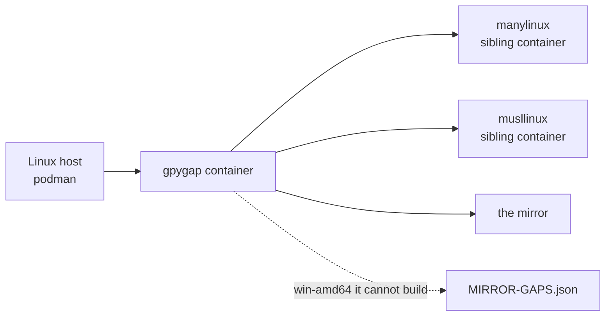
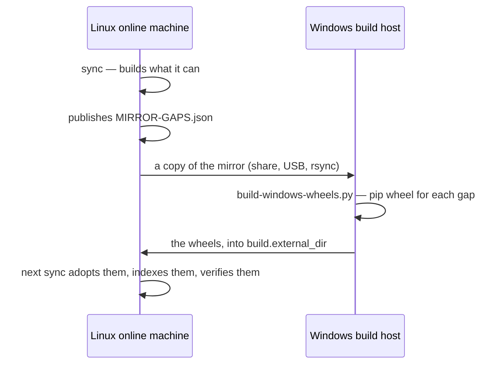
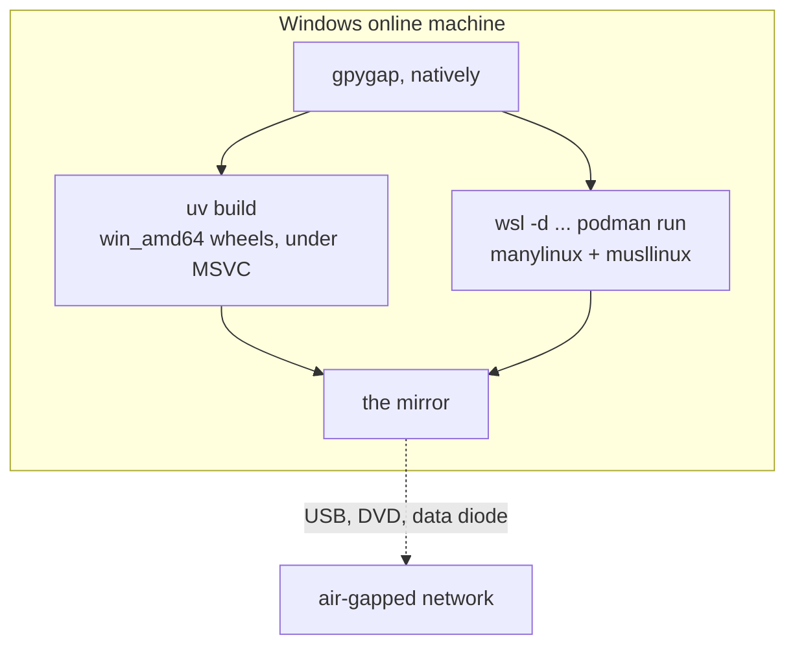

# Where to run it

gpygap needs one machine with internet access. Which operating system that machine runs
decides one thing only — **which wheels it can compile for the packages that ship none** —
and that is worth choosing deliberately, because it is the difference between developers
behind the air gap needing a compiler and not.

Everything else is identical in all three setups: the same code, the same configuration
file, the same mirror layout, the same deltas.

## Choosing

| | A. Linux | B. Linux + a Windows builder | C. Windows |
| --- | --- | --- | --- |
| Machines | 1 | 2 | 1 |
| manylinux / musllinux wheels | built | built | built, through WSL2 |
| `win_amd64` wheels | **not built** | built, on the second machine | built, on the same machine |
| `py3-none-any` wheels | built, and they cover Windows too | built | built |
| macOS wheels | never | never | never |
| One command per run | yes | no — two phases | yes |
| Tested by CI | fully | fully | mirror and Windows wheels; not the WSL2 half |

**Pick A** if your Windows developers either install VS Build Tools or only ever need
packages that publish Windows wheels. Most of the top 1000 do, and the pure-Python
packages that do not are covered anyway: their `py3-none-any` wheels are built on Linux
and install everywhere.

**Pick B** if you already have a Windows machine on the online network and want the gaps
filled without changing where the mirror lives.

**Pick C** if you are starting from scratch and some of your developers are on Windows.
It is the only single machine that can compile for everything the mirror targets.

---

## A. Linux online machine

The default, and what the quickstart in `README.md` describes.



```bash
git clone https://github.com/FPGArtktic/gpygap && cd gpygap
bin/gpygap sync --plan-only          # sizes first; the full scope is tens of GB
bin/gpygap sync
```

Everything runs in podman. The wrapper hands the container an engine socket so it can
start the builder containers, and takes it away again when the run ends. What it could
not build is listed in `MIRROR-GAPS.json` and named in the run report.

!!! tip "Keep it off the system disk"
    The mirror goes where `mirror.output` points, but container images do not. Set
    `GPYGAP_STORAGE=/srv/gpygap-containers` and the image store follows the mirror onto
    the same volume. See [Operations](operations.md).

---

## B. Linux online machine, Windows build host

Same as A, plus a second machine that fills what A reports as missing. The Windows
machine needs the MSVC Build Tools, a copy of the mirror, and nothing else — no gpygap
installation, no configuration.



On the Linux machine, once:

```toml
# gpygap.toml
[build]
external_dir = "/srv/incoming-wheels"
```

On the Windows machine, after every sync that reports gaps:

```powershell
python .\build-windows-wheels.py D:\mirror D:\wheels
```

Copy `D:\wheels` to `/srv/incoming-wheels` and run the next sync. It adopts them, records
them with `origin = "built"`, and counts them against the targets they cover. Run the
script once per Python version in `targets.python`; a pure-Python package needs only one
run, because its wheel covers every version at once.

This is the loop CI exercises on every push, so the path is kept honest.

---

## C. Windows online machine

The only single machine that can compile for every target the mirror serves: MSVC for
Windows wheels, and Linux containers through WSL2 for the rest.



### Setting it up

1. **Python and uv.** Install a Python from python.org and uv:
   ```powershell
   irm https://astral.sh/uv/install.ps1 | iex
   ```
2. **MSVC Build Tools**, for the Windows wheels. The "Desktop development with C++"
   workload is enough.
3. **WSL2 with a distribution and a container engine**, for the Linux wheels:
   ```powershell
   wsl --install -d Ubuntu
   wsl -d Ubuntu -- sudo apt-get update
   wsl -d Ubuntu -- sudo apt-get install -y podman
   ```
4. **gpygap:**
   ```powershell
   git clone https://github.com/FPGArtktic/gpygap
   cd gpygap
   uv sync
   ```

### Configuring it

```toml
# gpygap.toml
[targets]
python = ["3.11", "3.12", "3.13"]
platforms = ["linux-x86_64", "linux-musl-x86_64", "win-amd64"]

[build]
wheels = true
# One engine as far as you are concerned, four words as far as argv is concerned.
# When the command starts with wsl, paths are translated the way WSL sees them:
# C:\gpygap\mirror becomes /mnt/c/gpygap/mirror.
engine = "wsl -d Ubuntu podman"
```

### Running it

```powershell
uv run gpygap sync --plan-only
uv run gpygap sync
```

One command. Windows wheels are compiled in process with the host toolchain; Linux
wheels are compiled in podman inside WSL2, in containers with no network, exactly as they
are on a Linux host.

### What is different, and worth knowing

**The Windows wheels are built outside a container.** This is the one place the project
does that, and it is not an oversight: a Windows wheel needs MSVC, MSVC needs Windows,
and no container changes either fact. It is the same exposure a developer accepts when
pip builds a package from source on their own machine — which is precisely what mirroring
the wheel exists to spare them. If that is unacceptable in your environment, use setup A
or B and keep every build inside a container.

**CI covers half of this.** The `mirror-windows` job runs gpygap natively on a Windows
runner, builds the Windows wheels and installs from the result offline. It does not
cover the WSL2 half: a GitHub-hosted Windows runner has Docker in Windows-container mode
and no Docker Desktop. See [Continuous integration](ci.md).

**Docker Desktop works too**, in place of podman inside WSL. Set `engine = "docker"`; it
accepts Windows paths directly, so no translation is needed.

---

## What none of them can do

macOS. No host builds macOS wheels: the toolchain only runs on macOS, and Apple's licence
keeps it there. Add `macos-arm64` to `targets.platforms` to mirror the wheels that exist
upstream, and expect `MIRROR-GAPS.json` to name the rest.
