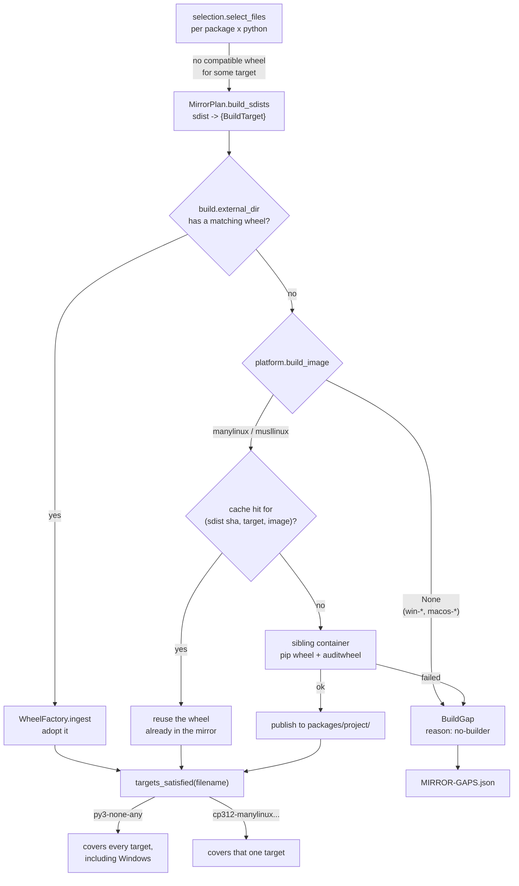
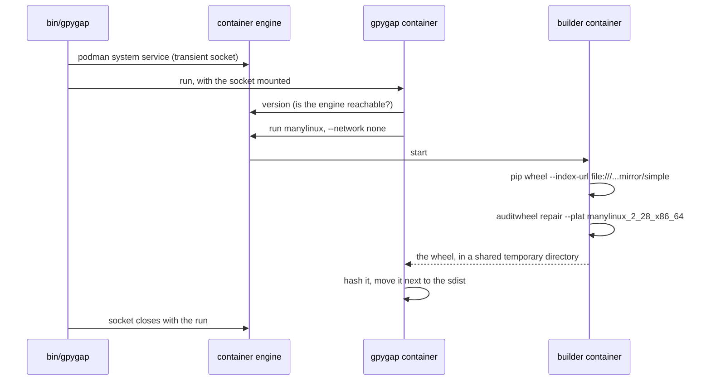
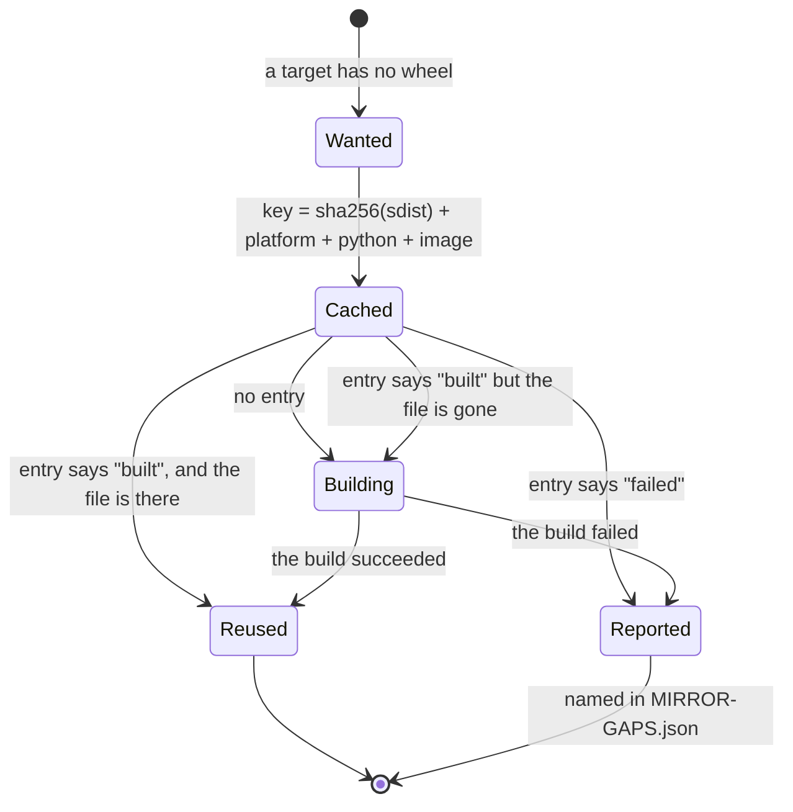

# Wheels the mirror builds itself

A package with no wheel for a platform used to mean the developer compiled it at install
time, on a machine that then needed a compiler, headers and sometimes Rust. In an
air-gapped network that is the difference between `pip install` working and a ticket. So
the online side builds the wheel while it still has a toolchain and the mirror to resolve
build requirements from, and the air-gapped side installs a binary like any other.

The rule this gives the mirror is testable in one line: **every in-scope requirement
installs with `--only-binary :all:` on every target it supports.** CI checks exactly that,
offline, from containers of seven Linux distributions and from a Windows runner.

## What happens, and where



## Builds run in a sibling container, not in this one

The mirror's own image has no compilers, on purpose: a build check only has to prove that
build requirements resolve, and without a compiler it reaches that conclusion in seconds.
Wheel building needs the opposite, so it happens somewhere else entirely — the pypa
`manylinux` and `musllinux` images, which carry the right libc floor, every CPython the
mirror targets (including the free-threaded builds) and `auditwheel`.



The project directory is mounted at the same absolute path inside the container as
outside, which is what makes this work: a sibling container mounts the same host path at
the same path, so every mirror-relative path still resolves. The builder gets
`--network none` and sees the mirror read-only.

Passing a container engine socket into a container is giving it the ability to start
containers, which on a single-user build host is the same authority it already has.
`GPYGAP_NO_BUILD_SOCKET=1` withholds it; the run then reports gaps instead of filling
them.

!!! note "podman is driven by its own client"
    podman also serves a Docker-compatible API, but a container created through that
    layer comes up unable to fork — the same container created through podman's own API
    is fine. The image therefore carries both clients and picks the one that matches the
    socket it was given.

## One build can cover more than it was asked for

A pure-Python sdist builds to `py3-none-any`, and that wheel installs on Windows, on musl
and on aarch64 just as well as on the machine that produced it. Most projects that publish
no wheel *at all* are pure Python, so the first build of an sdist often closes every gap
it had, Windows included. That is why each sdist's targets are tried in sequence rather
than in parallel: the first result usually makes the rest unnecessary.

A compiled extension is the other case. There one build serves one interpreter on one
platform, so `pysendfile` needs four builds for four Python versions, and `auditwheel`
retags each to `manylinux_2_28_x86_64` so clients recognise it.

## Windows and macOS are not built here, deliberately

| Route | Why it does not work |
| --- | --- |
| `microsoft/windows` images | A container shares the host kernel, and a Linux kernel does not execute PE binaries. They need a Windows host in Windows-container mode. |
| xwin + clang-cl | Solves the *toolchain* — it fetches Microsoft's CRT and SDK legally and cross-compiles. It does not solve the *build system*: setuptools takes the target from the running interpreter, so on Linux it emits a `.so` and tags the wheel `linux_x86_64`. `crossenv` targets Unix hosts, not win32. |
| .NET native AOT cross-compilation | A self-contained .NET toolchain; CPython extensions share none of it. |
| Wine + MSVC under Wine | Works, because the interpreter that runs really is Windows Python. Considered and rejected: fragile, and it needs a Visual Studio licence. |

What covers Windows instead is three things, in order of how much they carry:

1. **The `py3-none-any` wheels built here**, which install on Windows unchanged.
2. **A Windows builder**, which needs no gpygap on the Windows side at all. The mirror
   publishes `MIRROR-GAPS.json`; a Windows machine — a build host on the online network,
   or a CI runner — reads it, runs `pip wheel` against the mirror's own index, and drops
   the results where `build.external_dir` points. The next run adopts them. CI does
   exactly this between its two mirror passes, which is also how it would run monthly.
3. **The compiler on the developer machine**, for whatever is left. The report names those
   packages, so the list is short and known rather than discovered at `pip install` time;
   `vs_BuildTools.exe --layout` produces an offline installer that crosses the air gap.

The same mechanism works in the other direction for pure-Python packages: a wheel a
Windows machine built from a pure-Python sdist is `py3-none-any`, and the mirror credits
it to the Linux targets too. For compiled extensions it does not, for the same reason in
reverse.

## When a build fails

Three things end up in `MIRROR-GAPS.json`, and only one of them is genuinely nobody's
fault.

| `reason` | What happened | Is it fine? |
| --- | --- | --- |
| `no-builder` | Nothing here can compile for that platform — `win-amd64` or macOS from a Linux host. | Yes, and it is the documented gap. A Windows builder or `build.external_dir` closes it. |
| `build-failed` | The build ran and did not produce a wheel. | **Usually not.** See below. |
| `no-engine` | No container engine was reachable, so nothing was built at all. | No. The mirror is missing every wheel it was asked to compile. |

`build-failed` covers two cases that deserve to be told apart, and the error in
`<run>.log` says which:

**The project does not support that interpreter.** A C extension that has not been
updated for 3.14, a `python_requires` that excludes the version. Nothing the mirror can
do, and nothing a developer could have done either.

**The builder image is missing a system library.** `fatal error: libpq-fe.h: No such
file or directory` means `psycopg2` wanted `libpq-devel` and the manylinux image does not
carry it. This one is **not** acceptable to wave through: the developer on the other side
of the air gap hits the same wall, and worse, because they cannot install the headers
either. It is also the one you can fix.

### Giving the builder what it needs

`build.images` points a platform at your own image. Derive it from the pypa one so the
libc floor and `auditwheel` come along:

```dockerfile
# manylinux-with-libs
FROM quay.io/pypa/manylinux_2_28_x86_64:2026.10.10-1
RUN dnf -y install libpq-devel openldap-devel libffi-devel && dnf clean all
```

```toml
[build]
images = [
    "linux-x86_64=registry.example.local/manylinux-with-libs:2026.10.10",
    "linux-musl-x86_64=registry.example.local/musllinux-with-libs:2026.10.10",
]
```

The resulting wheel still installs on a machine without those libraries, because
`auditwheel repair` copies the shared objects it links against into the wheel and
rewrites the RPATH. That is the whole point of the manylinux process, and it is why this
works rather than merely moving the problem.

Two things to keep in mind. The image name is part of the build cache key, so changing
it rebuilds everything that image can build — deliberate, because a wheel built against
different libraries is a different wheel. And vendoring a library into a wheel
redistributes it: check that its licence allows that before adding it, particularly for
anything copyleft.

## Rebuilding only what changed



The key is the sdist's hash, the target and the builder image, so a monthly resync
rebuilds only what genuinely changed, and bumping the builder image is a deliberate act
that rebuilds everything. Failures are cached too: a package that cannot be built is not
retried every month, and the operator sees the same named gap until an input changes.

A cache entry whose wheel is no longer on disk is dropped rather than believed. Reporting
a gap for a file we know how to recreate would be a lie that survived every later run.

`SOURCE_DATE_EPOCH` is pinned to 1980-01-01 — the earliest timestamp a zip entry can
carry — so two builds of the same sdist are byte-identical and a resync that rebuilds
nothing also rewrites nothing. Deltas stay small.

## What a built wheel looks like in the mirror

It sits next to the sdist it came from, in `packages/<project>/`, and the simple index
links it like any other file, with its SHA-256, its `data-requires-python` and a PEP 658
metadata sidecar. Two things mark it as ours:

- `origin = "built"` in the manifest. It has no upstream URL, so nothing can re-download
  it; losing it means rebuilding it, which is why `sync._commit` is handed the builder's
  files explicitly — without that the prune would delete a file nothing can fetch again.
- its path appears in `built_wheels` in `MIRROR-INFO.json`, which crosses the air gap, so
  the offline side can tell at a glance which wheels did not come from PyPI.

An upstream wheel of the same name always wins. It is the artifact the project published
and its hash is the one the lock file recorded.

## Configuration

See `gpygap.toml` for the documented defaults. The settings are `build.wheels` (on),
`build.external_dir` (where wheels built elsewhere are dropped), `build.engine` (`auto`),
`build.images` (per-platform overrides), `build.exclude`, `build.jobs` and
`build.timeout`.
